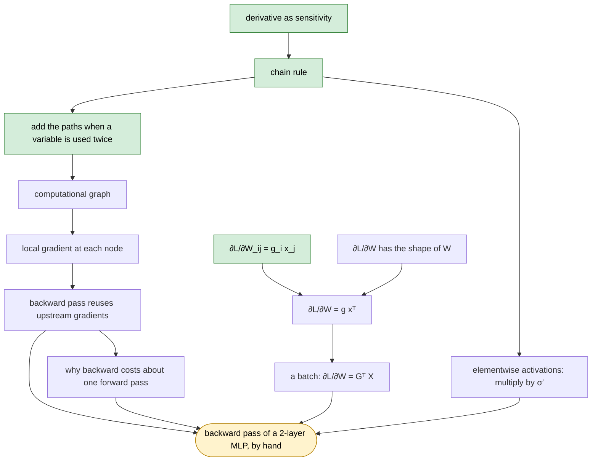

# claude-tutor

A Claude Code skill that teaches you a subject the way a good private tutor would. It first figures out what you already know, then teaches in small steps and quizzes you after each one.

The method and most of the rules come from [LearnHarness](https://github.com/amosblomqvist/learnharness), a desktop app by Amos Blomqvist. I wanted the same kind of teaching inside Claude Code without running a separate app, so I adapted its agent prompts into a skill. If you'd rather have a proper UI with a knowledge graph, use the original.

Some rules come from Jane Street's [socratic-tutor](https://github.com/janestreet/agent_skills) skill: the 0–5 level for each topic and the progress map, the habit of answering a wrong answer with a narrower question instead of the correction, and the final exam.

## How a course goes

You start by saying what you want to understand. "Understand transformers" could mean a dozen different things, so the first few questions are about the goal itself. After that it quizzes you on whatever the goal depends on (for backprop that's derivatives, the chain rule, matrix shapes and so on). It starts near the hard end of each topic and moves down when you miss, until it knows where your knowledge actually stops.

Then it draws a plan as a mermaid graph, with a few basic facts at the bottom and your goal at the top, and waits for you to OK it. Teaching follows the plan, but the plan gets redrawn whenever your answers show it guessed wrong about you.

Every step has the same shape. You're asked to guess what comes next; the tutor explains, starting from your guess; then a check question makes you use the idea on a case you haven't seen. If you miss the check, it goes back and fixes that step before moving on.

Practice happens in a separate session. The problems mix topics on purpose, and hints come one at a time: the first ones only point at something in the problem, and the last one shows the step. Anything you missed comes back later in a different form.

Build sessions are for code. You write something real, say an MLP with backprop done by hand, writing the tests first. The tutor reviews it against ub-mode (see below) one issue at a time. It won't rewrite your code for you.

Each topic gets a level from 0 (never heard of it) to 5 (could teach it and handles the edge cases). A level only goes up after two separate checks, and one of them has to come later, when the idea isn't fresh. Old topics come back without warning, and a failed one drops a level. When you miss a check, you usually get a smaller question that shows where your reasoning breaks, and a direct explanation only after two or three tries. Once every topic on the way to your goal is at 4 (or 5 if you asked for full mastery), there's a final exam: a question per topic and one problem that needs all of them.

With every answer you give a confidence percentage and a few lines of your reasoning. The reasoning is what it learns the most from. A wrong answer at 90% confidence gets a lot more attention than a wrong guess at 30%.

## Install

As a plugin, from inside Claude Code:

```
/plugin marketplace add Kratosyan7/claude-tutor
/plugin install tutor@claude-tutor
```

Or copy the skill folder by hand:

```bash
git clone https://github.com/Kratosyan7/claude-tutor
cp -r claude-tutor/plugins/tutor/skills/tutor ~/.claude/skills/tutor
```

### ub-mode

If you'll be writing code, install Uncle Bob's [ub-mode](https://github.com/unclebob/ub-mode) skill too:

```bash
git clone https://github.com/unclebob/ub-mode
mkdir -p ~/.claude/skills/ub-mode && cp ub-mode/SKILL.md ~/.claude/skills/ub-mode/
```

The tutor follows it in the code it writes (demos, model solutions) and uses it as the standard when it reviews yours. Without it there's a short set of TDD rules built in. I can't include ub-mode in this repo because it has no license. Its companion tools, [crapper](https://github.com/unclebob/crapper), [dryer](https://github.com/unclebob/dryer) and [mutator](https://github.com/unclebob/mutator), are optional; the tutor runs them if they're installed.

## Usage

```
/tutor probe I want to be able to derive backpropagation by hand
/tutor teach
/tutor build an MLP in numpy with hand-written backprop
/tutor practice
```

During a course you can say "show progress", "harder", "easier", or "just tell me" (skips the questions for the current step).

You don't have to name a phase. Saying "teach me how TCP congestion control works" is enough to start it. It answers in the language you write in.

## Example: a short course on backprop

This is a shortened course with the goal "derive backpropagation by hand". The tutor's messages are trimmed, and the learner's answers were made up for the example. The math in them was checked numerically. The plan graph is an ordinary mermaid block, so GitHub draws it here the same way Claude Code shows it in the chat.

<details>
<summary>Probe: finding where your knowledge stops</summary>

> **Tutor:** What should you be able to do when we're done?
> 1. Derive it myself: work out the gradients of a small network on paper with the chain rule
> 2. Implement it from scratch in numpy, without autograd
> 3. Understand what `loss.backward()` does in PyTorch
> 4. Get the intuition, without formulas
>
> **You:** 1

> **Tutor:** Let $u = w x$, then $v = w u$, and the loss is $L = v$. Here $x$ is a constant, and the same $w$ appears in both places. What is $dL/dw$?
> (a) $wx$ (b) $2wx$ (c) $w^2x^2$ (d) $wx + w$. Add your confidence and a line of reasoning.
>
> **You:** (b), 80%. w shows up twice, so there are two paths to L and I add them.

> **Tutor:** Layer $z = Wx$, with $W$ of size $m \times n$. You're given $g = \partial L / \partial z$. What is $\partial L / \partial W$?
> (a) $W^\top g$ (b) $x g^\top$ (c) $g x^\top$ (d) $g \odot x$
>
> **You:** (d), 60%. dz/dW is x, times the gradient coming from above.
>
> **Tutor:** That's not right. We'll get to why in the lesson; right now I'm only measuring. Same layer, one element at a time: $z_i = \sum_j W_{ij} x_j$. What is $\partial L / \partial W_{ij}$?
>
> **You:** $g_i x_j$, 70%. Only $z_i$ uses $W_{ij}$, and the derivative of that term is $x_j$.

After a few more questions the tutor writes `~/learning/ml/learner-map.md`:

```markdown
### Chain rule, scalar  (probed 2026-10-30)
- Level: 4
- Floor: adds contributions when a variable reaches the loss by two paths (Q2, 80%)
- Ceiling: not reached; held up on everything asked

### Gradients with respect to matrices  (probed 2026-10-30)
- Level: 2
- Floor: per-element dL/dW_ij = g_i x_j (Q4, 70%)
- Ceiling: can't put the per-element results back together into a matrix (Q3: picked g ⊙ x, 60%)
- Misconception: carries the scalar rule "dz/dw = x" over to matrices elementwise;
  g ⊙ x can't even have the right shape when m ≠ n
- Build from: the per-element derivative
```

and shows the starting levels:

```
Goal: derive backprop by hand              overall  ████░░░░░░  40%
------------------------------------------------------------------
chain rule, scalar        ████░  4/5
gradients wrt matrices    ██░░░  2/5
computational graph       █░░░░  1/5
cost of backward pass     █░░░░  1/5
------------------------------------------------------------------
```

</details>

For the plan, the tutor explains its approach in a few sentences. You already handle the chain rule and the per-element derivative, so the lesson starts there and spends most of its time on putting those numbers back together into matrices, plus why the backward pass is cheap. Then it draws the map below and waits for your OK. Green nodes are what the probe showed you already know.



<details>
<summary>Teach: one step, with a guess before it and a check after</summary>

> **Tutor (guess first):** You already know each entry: $\partial L / \partial W_{ij} = g_i x_j$. $W$ has $m \cdot n$ entries, $g$ has $m$, $x$ has $n$. Which single operation on $g$ and $x$ gives you all $m \cdot n$ numbers at once?
>
> **You:** Multiply them? They're different lengths though, so maybe $g x^\top$? 40%

> **Tutor:** Your guess is right, and the length mismatch you noticed is the reason it works. Entry $(i, j)$ has to be $g_i$ times $x_j$, with every $i$ paired with every $j$. That's the outer product: an $m \times 1$ column times a $1 \times n$ row is an $m \times n$ matrix whose $(i,j)$ entry is $g_i x_j$.
>
> $$\frac{\partial L}{\partial W} = g\,x^\top$$
>
> It comes out the same shape as $W$, and that's no coincidence. $L$ is a single number, so it has exactly one partial derivative per entry of $W$. Your earlier answer $g \odot x$ fails this test before you compute anything, since for $m \ne n$ it isn't even defined.
>
> Check: what about a batch? $X$ is $B \times n$ (one example per row), $Z = X W^\top$ is $B \times m$, and $G = \partial L / \partial Z$ is $B \times m$. What is $\partial L / \partial W$?
> (a) $X^\top G$ (b) $G W$ (c) $G^\top X$ (d) $\sum_b g_b \odot x_b$
>
> **You:** (c), 75%. It has to be $m \times n$. $G^\top$ is $m \times B$, $X$ is $B \times n$.
>
> **Tutor:** Correct, and the shape argument is the move that settles it. (a) is $n \times m$, which is $W$ transposed. (b) is $\partial L / \partial X$, the gradient for the input.

</details>

<details>
<summary>Practice: a problem, a hint, a retest</summary>

> Problem 3. An autoencoder with tied weights: $h = Wx$, $\hat{x} = W^\top h$, $L = \tfrac12 \lVert \hat{x} - x \rVert^2$, where $W$ is $k \times n$. Find $\partial L / \partial W$ in terms of $W$, $x$, $h$ and $r = \hat{x} - x$.
>
> **You:** $\partial L / \partial W = W r x^\top$
>
> **Tutor:** Not complete. The term you have is correct as far as it goes. Count how many times $W$ appears in the forward pass.
>
> **You:** Twice, encoder and decoder. Through the decoder $\hat{x} = W^\top h$, so the gradient for $W^\top$ is $r h^\top$, which is $h r^\top$ for $W$. Total: $h r^\top + W r x^\top$
>
> **Tutor:** Correct. What made it work was adding the two paths: the same rule as the first probe question, now with matrices.

The miss goes into `practice-log.md`, and the same idea comes back at the end of the session in a different setting:

```markdown
- P3 "add the paths when a variable is used twice": recall. 2026-11-02 problem 3:
  cue miss (one path only), fixed after the first hint. Retest: problem 7, solved without hints.
```

</details>

<details>
<summary>Build: test first, with ub-mode</summary>

You write the test before the code. `numeric_grad` comes from the tutor, since it's a helper and not the thing you're learning:

```python
def test_linear_backward_matches_numeric():
    rng = np.random.default_rng(0)
    X, W = rng.normal(size=(4, 3)), rng.normal(size=(2, 3))
    G = rng.normal(size=(4, 2))
    dW = linear_backward(X, W, G)
    assert np.allclose(dW, numeric_grad(lambda W: (G * (X @ W.T)).sum(), W))
```

> **Tutor:** Before you run it, why should it fail?
>
> **You:** `linear_backward` doesn't exist yet.
>
> **Tutor:** It will fail for that reason, but that failure tells you nothing about the math. Add a stub that returns `np.zeros_like(W)`, so the test fails on the assertion. Then write the smallest version that passes.

</details>

## Where your progress goes

Everything is plain markdown in `~/learning/<subject>/`, so you can open and edit it yourself:

| File | Contents |
|---|---|
| `learner-map.md` | Your goal, and for each topic what you know solidly, where you start getting it wrong, and any misconceptions |
| `propositions.md` | What you've been taught, written as short claims and the chains of reasoning between them |
| `sessions/*.md` | One file per session with the plan, the questions, and your answers |
| `practice-log.md` | How each idea has held up in practice |

Each new session reads these files first and continues from where you left off.

## Files

```
.claude-plugin/marketplace.json
plugins/tutor/.claude-plugin/plugin.json
plugins/tutor/skills/tutor/SKILL.md          # core rules: tone, accuracy, questions, levels, progress files
plugins/tutor/skills/tutor/references/
  probe.md                                    # finding what you already know
  teach.md                                    # planning and the guess/explain/check cycle
  practice.md                                 # practice sessions, hints, final exam
  code.md                                     # working with ub-mode, code review, build sessions
```

## License

AGPL-3.0-only, same as LearnHarness (see [LICENSE](LICENSE)). The parts taken from socratic-tutor were MIT-licensed; their notice is kept in [NOTICE.md](NOTICE.md), which also lists the files this was adapted from and what was changed.
